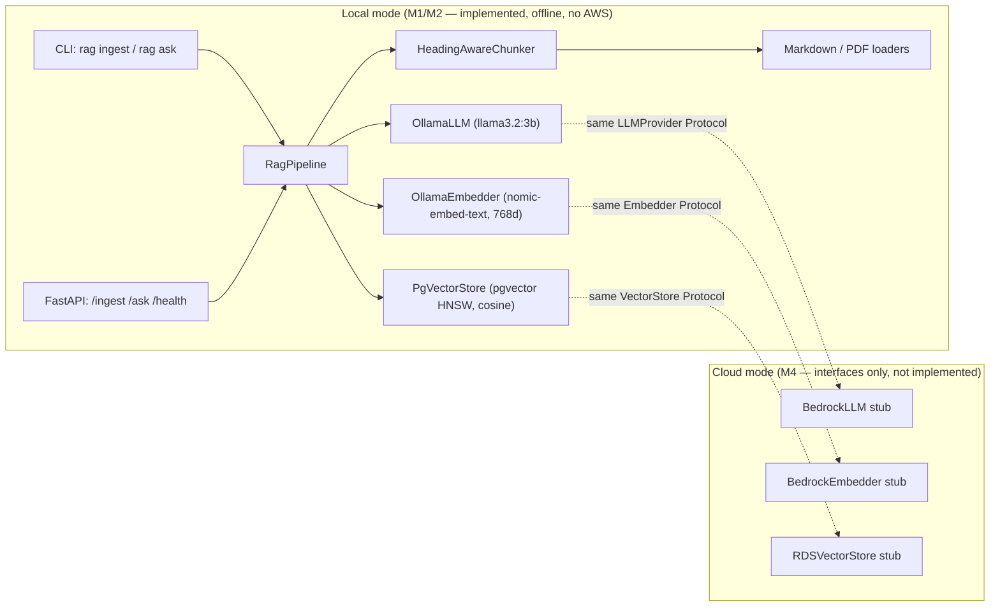

# bedrock-rag-platform

A production-shaped, **local-first** RAG platform that answers grounded
questions about real open-source infrastructure docs (Karpenter, KEDA) using
local models — zero cloud credentials required. Clean backend interfaces mean
swapping in AWS Bedrock + OpenSearch Serverless later (M4) is a config change,
not a rewrite.

## The pitch: before / after

Asked **without** retrieval, a small local model (`llama3.2:3b`) answers:

> **Q: What is Karpenter?**
> **A (no RAG):** *"The Carpenter is a position in the British Armed
> Forces, equivalent to a Sergeant."*

It confidently hallucinates (and mis-hears "Karpenter" as "Carpenter") —
Karpenter is a Kubernetes node-autoscaler, not a military rank. Asked
**with** retrieval over the actual Karpenter docs:

> **A (RAG):** *"Karpenter is an open-source node lifecycle management
> project built for Kubernetes. It watches for unschedulable pods, evaluates
> their scheduling constraints, provisions nodes that meet those
> requirements, and disrupts nodes when they are no longer needed [1]."*
> `[1] karpenter/index.md`

Same model, same hardware — the only difference is grounding the answer in
retrieved context and forcing citations. That gap is the whole point of this
project.

## Architecture



Every backend (LLM, Embedder, VectorStore, DocumentLoader) is defined as a
`typing.Protocol` in `interfaces/protocols.py`. `rag/factory.py` wires
concrete implementations based on `Settings`. Local mode (Ollama + pgvector)
is fully implemented; `providers/bedrock_stubs.py` documents the Bedrock/RDS
shape for M4 without implementing it, so core logic never has to change
when cloud backends land.

## Quickstart

Requires: Python 3.12, [uv](https://docs.astral.sh/uv/), Docker, and a local
[Ollama](https://ollama.com) with `ollama pull llama3.2:3b` and
`ollama pull nomic-embed-text`.

```bash
uv sync
make up                      # starts pgvector (Postgres 16 + pgvector)
make fetch-corpus             # downloads a pinned subset of Karpenter + KEDA docs
make ingest                   # chunks, embeds, and stores the corpus
make ask Q="What is Karpenter?"
make eval                     # retrieval + abstention metrics -> eval/report.md
```

Or via the CLI directly:

```bash
uv run rag ingest data/corpus
uv run rag ask "What does KEDA's AWS SQS scaler use to determine replicas?"
```

Or via the API (`uv run uvicorn bedrock_rag_platform.api.app:app --reload`):

```bash
curl -X POST localhost:8000/ingest -d '{"path": "data/corpus"}' -H 'content-type: application/json'
curl -X POST localhost:8000/ask -d '{"question": "What is Karpenter?", "top_k": 4}' -H 'content-type: application/json'
```

Running the API + DB together, with host Ollama reached via
`host.docker.internal`: `make up` (brings up both `db` and `api` containers;
see `docker-compose.yml`). Set `OLLAMA_BASE_URL` if Ollama isn't on the
default port.

## Evaluation (M2)

`eval/dataset.jsonl` has 35 hand-written Q&A pairs grounded in the fetched
corpus (30 answerable + 5 intentionally unanswerable, e.g. "What is the
capital of France?"). `eval/run_eval.py` computes:

- **Retrieval metrics** (no LLM, full 30-question answerable set): Hit@k,
  Recall@k, MRR — whether the correct source file is retrieved, and how high.
- **Abstention correctness**: does the system say "I don't know" on the 5
  unanswerable questions instead of hallucinating?
- **Before/after baseline**: no-RAG vs. RAG answers on 3 sample questions.
- An *optional*, explicitly weak LLM-as-judge faithfulness score (same small
  local model judging itself — treat as a rough signal only).

### Real results (local run, `llama3.2:3b` + `nomic-embed-text`, CPU)

| Metric | Value |
|---|---|
| Hit@4 (retrieval, 30 answerable questions) | 96.67% |
| Recall@4 | 93.06% |
| MRR | 0.894 |
| Abstention correct (5 unanswerable questions) | 5/5 |
| Full eval wall time (10-question generation sample) | 267s |

Before/after on the demo question, straight from `eval/report.md`:

- **No-RAG:** *"The Carpenter is a position in the British Armed Forces,
  equivalent to a Sergeant."*
- **RAG:** *"Karpenter is an open-source node lifecycle management project
  built for Kubernetes [1]. It is designed to improve the efficiency and
  cost of running workloads on a Kubernetes cluster by automatically
  provisioning and managing nodes [1]."*

Full per-question retrieval breakdown and all sampled generated answers are
in `eval/report.md` / `eval/report.json`. Generation (LLM calls) is
CPU-bound and slow (~6-20s per answer with `num_predict=256`), so by default
`run_eval.py` only generates real answers for the 5 unanswerable rows plus a
10-question sample (`--full-generation` runs all 35 if you have time).
Retrieval metrics always cover the full 30-question answerable set since
they need no LLM call.

## Design decisions (ADR-style)

- **pgvector, not an external vector DB, for local mode.** One fewer moving
  part offline; HNSW + cosine distance on Postgres is plenty fast at this
  corpus size (hundreds of chunks), and the same SQL mental model carries
  over to Aurora/RDS + pgvector later if that's the M4 cloud path chosen.
- **Heading-aware chunking.** Splitting on markdown headings before falling
  back to paragraph/sentence splitting keeps citations meaningful ("KEDA
  Concepts > Scaling Deployments" vs. an anonymous byte offset) and avoids
  cutting a concept in half mid-explanation.
- **Protocol interfaces + factory, not inheritance.** `LLMProvider`,
  `Embedder`, `VectorStore`, `DocumentLoader` are structural `Protocol`s.
  Local and future Bedrock/OpenSearch implementations satisfy the same
  contract without a shared base class; `rag/factory.py` is the only place
  that knows which concrete class to instantiate.
- **Asymmetric embedding prefixes matter.** `nomic-embed-text` is trained
  with `search_query:` / `search_document:` task prefixes; dropping them
  measurably hurt retrieval during development. Both prefixes are applied
  inside `RagPipeline`, not the `Embedder` implementation, so the interface
  stays generic for embedding models that don't need them.
- **Deterministic, pinned corpus fetcher.** `scripts/fetch_corpus.py`
  downloads an explicit file list at a pinned tag/commit SHA (not "latest"),
  so the corpus — and therefore `eval/dataset.jsonl`'s expected answers and
  sources — stays reproducible across runs.
- **Fakes over mocks for unit tests.** `FakeEmbedder` (deterministic SHA256
  hashing), `FakeLLM`, and `InMemoryVectorStore` let the full unit suite run
  with zero network calls and zero flakiness; `respx` mocks only the Ollama
  HTTP boundary where a fake would hide a real wire-format bug.

## Roadmap (per the portfolio plan)

- **M1 — Local core** ✅ FastAPI + CLI, Ollama LLM/Embedder, pgvector store,
  markdown/PDF loaders, heading-aware chunker, grounded prompting with
  citations, docker-compose, Makefile.
- **M2 — Evaluation** ✅ hand-written eval dataset, retrieval + abstention
  metrics, no-RAG baseline, unit tests with fakes (≥85% coverage), pgvector
  integration test, CI (lint/type/test/integration/docker-build jobs).
- **M3 — Hardening** (planned): reranking, hybrid search (lexical + vector),
  structured logging/tracing, upload-based ingestion in the API, larger
  corpus, streaming answers.
- **M4 — AWS Bedrock mode** (planned, needs an AWS account): implement
  `BedrockLLM`, `BedrockEmbedder`, `RDSVectorStore` (or OpenSearch
  Serverless) behind the existing Protocols; `Settings.llm_backend` etc.
  become `"bedrock"`; no changes to `RagPipeline`, the API, or the CLI.
- **M5/M6** (planned): Terraform for the AWS footprint, auth, multi-tenant
  corpora, cost tracking.

## Limitations (honest)

- CPU-only `llama3.2:3b` is slow and a weak reasoner; answers are short and
  sometimes mechanically cite the right source while slightly misstating a
  detail. This is a demo-scale model, not a production LLM choice.
- No reranking: retrieval is plain cosine similarity over chunk embeddings.
  Recall can be imperfect, especially on multi-source comparison questions.
- The corpus is intentionally small (~30 pages, pinned) — recall numbers
  would differ on the full documentation sets.
- The LLM-as-judge score is explicitly weak (uncalibrated, self-evaluating)
  and should not be read as a quality guarantee.
- No auth, rate limiting, or multi-tenancy — out of scope until M4+.

## Development

```bash
make lint        # ruff check
make fmt         # ruff format
make typecheck    # mypy src (strict)
make test         # unit tests, ≥85% coverage gate
make test-integration  # real pgvector via docker, FakeEmbedder-sized vectors
```

Pre-commit hooks mirror CI (`.pre-commit-config.yaml`): ruff lint + format,
mypy, and standard hygiene hooks.
